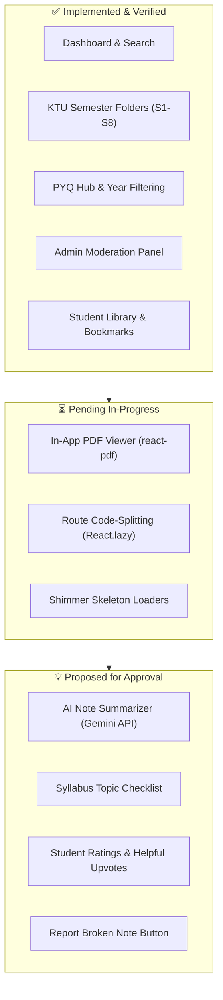

# Project Resumption Documentation: EduCrate 2.0

> **Document Purpose:** This document establishes the exact state of EduCrate 2.0 to enable immediate resumption of development without repeating prior analysis, losing project context, or violating established architectural and security decisions.

---

## 1. Preserved Original Project Outline

*The following outline is reproduced verbatim and without modification from the original project specification and `README.md`.*

---

```markdown
# EduCrate

## 1. Introduction
EduCrate is a full-stack web application built using the MERN stack designed to help students discover, share, and manage academic resources such as previous year questions (PYQs) and lecture notes. It provides a secure platform featuring user authentication via Firebase, dedicated student dashboards to track uploaded resources, and cloud-based file management utilizing Cloudinary.

## 2. Tech Stacks Used

### Frontend (client)
- **Framework:** React 18 with Vite
- **Styling:** Tailwind CSS & Autoprefixer
- **Routing:** React Router DOM
- **Authentication:** Firebase Auth
- **Icons:** Lucide React
- **HTTP Client:** Axios

### Backend (server)
- **Environment:** Node.js
- **Framework:** Express.js
- **Database:** MongoDB with Mongoose
- **File Uploads:** Multer & Cloudinary
- **Security:** Helmet, Express Rate Limit, Express Mongo Sanitize, cors, bcryptjs
- **Authentication:** JSON Web Tokens (JWT) & Firebase Admin SDK

## 3. Installation and Setup

### Prerequisites
Before you begin, ensure you have the following installed on your local machine:
- [Node.js](https://nodejs.org/)
- npm or yarn
- MongoDB (local or Atlas cluster)
- [Firebase account](https://firebase.google.com/)
- [Cloudinary account](https://cloudinary.com/)

### Clone the repository
```bash
git clone https://github.com/MabelMoncy/EduCrate2.0
cd EduCrate2.0
```

### Install Dependencies

**For Backend (Server):**
```bash
cd server
npm install
```

**For Frontend (Client):**
```bash
cd ../client
npm install
```

### Environment Configuration
The project requires environment variables for both the client and server. 
You can use the provided `.env.example` file in the root directory as a reference.

1. Create a `.env` file in the `server` directory and add the following keys:
```env
PORT=5000
NODE_ENV=development
MONGODB_URI=<Your MongoDB Connection String>
JWT_SECRET=<Your JWT Secret Key>
CORS_ORIGINS=http://localhost:3000
CLOUDINARY_CLOUD_NAME=<Your Cloudinary Cloud Name>
CLOUDINARY_API_KEY=<Your Cloudinary API Key>
CLOUDINARY_API_SECRET=<Your Cloudinary API Secret>
FIREBASE_PROJECT_ID=<Your Firebase Project ID>
FIREBASE_CLIENT_EMAIL=<Your Firebase Client Email>
FIREBASE_PRIVATE_KEY=<Your Firebase Private Key>
```

2. Create a `.env` file in the `client` directory and add the following keys:
```env
VITE_API_URL=http://localhost:5000
VITE_FIREBASE_API_KEY=<Your Firebase API Key>
VITE_FIREBASE_AUTH_DOMAIN=<Your Firebase Auth Domain>
VITE_FIREBASE_PROJECT_ID=<Your Firebase Project ID>
VITE_FIREBASE_APP_ID=<Your Firebase App ID>
```

## 4. How to run

To run the project locally, you will need to start both the frontend and backend development servers.

**Step 1: Start the Server (Backend)**
Open a terminal instance and navigate to the server folder:
```bash
cd server
npm run dev
```
The backend should now be running on `http://localhost:5000`.

**Step 2: Start the Client (Frontend)**
Open a new terminal instance and navigate to the client folder:
```bash
cd client
npm run dev
```
The frontend application will compile and become available at `http://localhost:3000`.
```

---

## 2. Resuming Development: Current Status & Constraints

### 2.1 What Has Already Been Implemented

1. **Backend Server Architecture (`server/`)**:
   - **Express 5.2.1** REST API configured with routing, middleware chain, and structured logging.
   - **Database Models (`server/models/`)**: `Resource`, `Student`, `User` (Admin), `AuditLog`, `Notification`, `PYQ`.
   - **File Processing Pipeline**: Multer memory storage piping buffers directly to Cloudinary streams; zero unencrypted temporary disk writes.
   - **Private Cloudinary Storage**: Cloudinary public IDs and direct file URLs are stripped from public responses; temporary signed URLs (10-minute expiry) are generated only for authenticated requests.
   - **Full Security Hardening Layer**:
     - Double-submit CSRF cookie protection (`csrfMiddleware.js`).
     - Admin authentication using `httpOnly`, `sameSite: 'strict'`, `secure` cookies with JTI token blacklist revocation (`tokenBlacklist.js`).
     - Student authentication via Firebase Admin SDK with `checkRevoked=true` and enforced email verification.
     - PDF Magic Bytes verification (`validatePdfMagicBytes` checking `%PDF-` / `0x25 0x50 0x44 0x46 0x2D`).
     - Query sanitization via `express-mongo-sanitize` adapted for Express 5.
     - Strict rate limiters for login attempts (5 per 10 min) and upload attempts (10 per 10 min).
     - Strict Content Security Policy and HSTS via `helmet`.
     - In-memory response caching for resource catalogues (`cache.js`).
     - Automated cron-based soft-deletion cleanup with 24-hour grace period (`cron/cleanup.js`).
   - **Server Test Suite**: 73 automated tests passing in `server/` using Node's built-in `node:test` runner.

2. **Frontend Client Architecture (`client/`)**:
   - **React 18 + Vite 6** with Tailwind CSS and custom "Deep Midnight" design system.
   - **Pages Implemented (`client/src/pages/`)**: `Dashboard`, `Semester` (S1–S8 folder browser), `Library` (personal bookmarks & uploads), `PYQHub`, `PYQYears`, `PYQSubjects`, `Account`, `About`, `Login`, `NotFound`.
   - **Admin Management (`client/src/pages/admin/`)**: `AdminLayout`, `AdminOverview`, `ResourceManagement`, `SubjectConfiguration`, `PYQManagement`.
   - **Components (`client/src/components/`)**: `TopNav`, `Sidebar`, `SemesterUploadModal`, `PYQUploadModal`, `PDFPreviewModal`, `NotificationBell`, `SignInPrompt`, `SplashScreen`, `FeedbackModal`, `ErrorBoundary`.
   - **PWA Integration**: `vite-plugin-pwa` configured with service worker caching.
   - **Curriculum Alignment**: KTU 2024 Scheme pre-configured for Semesters S1 through S8 with exact course codes.

### 2.2 What Remains to Be Completed

1. **In-App PDF Viewing**: Replace external Google Drive redirect tab in `PDFPreviewModal.jsx` with an in-app viewer using the installed `react-pdf` dependency.
2. **Client Bundle Optimization**: Implement route-level code splitting using `React.lazy()` and `Suspense` to resolve the 1,033 kB vendor bundle warning.
3. **Client-Side Test Coverage**: Expand client tests beyond `semesterData.test.js` to cover auth state, modals, and upload workflows.
4. **Server Test Isolation**: Mock Mongoose operations in unit test files (`cronController.test.js`, `authMiddleware.test.js`) so tests execute in <1s without MongoDB connection buffering timeouts.
5. **Multi-Instance Rate Limiting**: Transition in-memory rate limiting and token blacklisting to Redis (e.g., Upstash Redis) for horizontal scalability on containerized hosts.

### 2.3 Current Development Stage
- **Phase**: Late Alpha / Feature-Complete MVP.
- **Security Maturity**: High (All 10 security bug conditions from prior audit resolved and covered by automated regression tests).
- **Production Readiness**: Requires bundle code-splitting, in-app PDF viewer integration, and CI environment stabilization before public deployment.

### 2.4 Established Decisions and Constraints (Must Be Preserved)

1. **PDF Exclusivity**: Only `application/pdf` files with valid `%PDF-` magic header bytes are permitted. No conversion to external image formats or arbitrary document formats.
2. **Private File Delivery**: Direct Cloudinary download URLs must never be published in public catalogue listings. All file access must route through authenticated signed URL endpoints with short TTLs.
3. **No LocalStorage for Secrets**: Sensitive tokens (Admin JWT) must never be stored in browser `localStorage`. Cookies must remain `httpOnly`, `Secure`, and `SameSite=Strict`.
4. **CSRF Enforcement**: All mutating HTTP methods (`POST`, `PATCH`, `DELETE`) require the `X-CSRF-Token` header matching the client cookie, exempting only initial login.
5. **Auditing & Soft Deletion**: Records must not be hard-deleted on initial request. Use `isDeleted: true` with a 24-hour grace period and create an entry in `AuditLog`.
6. **KTU 2024 Scheme Compliance**: Semesters and subject names must validate against `VALID_SEMESTERS` and `SEMESTER_SUBJECTS` constants.

### 2.5 Known Issues and Pending Fixes

| Issue ID | Severity | Description | Target File(s) | Fix Summary |
| :--- | :--- | :--- | :--- | :--- |
| **ISSUE-01** | Medium | Large initial client bundle (`index-*.js` > 1 MB) triggering Vite chunk warning. | `client/src/App.jsx`, `client/vite.config.js` | Introduce `React.lazy()` for admin pages and modals; configure `manualChunks`. |
| **ISSUE-02** | Low | Server test execution delays (10s buffer timeout) during DB calls in `node:test`. | `server/controllers/cronController.test.js`, `server/middlewares/authMiddleware.test.js` | Mock Mongoose models or provide mock DB connection during unit test runs. |
| **ISSUE-03** | Low | Redundant duplicate status assignment. | `server/middlewares/protectStudent.js` | Remove duplicate line 50 (`if (res.statusCode === 200) res.status(401);`). |
| **ISSUE-04** | Low | Renovate automerging GitHub Action major versions. | `renovate.json` | Explicitly restrict automerge for `github-actions` managers to patch/minor only. |

### 2.6 Exact Next Steps (In Priority Order)

1. **Step 1 (Performance & Build):** Implement code splitting on `client/src/App.jsx` to reduce main bundle size below 300 kB.
2. **Step 2 (UX Completion):** Wire `react-pdf` into `client/src/components/PDFPreviewModal.jsx` to provide an in-modal reader with page controls and dark-mode framing.
3. **Step 3 (CI Stabilization):** Add a MongoDB service container to `.github/workflows/ci-quality-security.yml` and correct Node version step titles.
4. **Step 4 (Test Expansion):** Add frontend component tests for `PDFPreviewModal` and `SemesterUploadModal`.
5. **Step 5 (Production Preparation):** Configure environment validation checks on server startup using Zod or Joi to prevent boot with missing secrets.

---

## 3. Testing and Configuration Validation

### 3.1 Remaining Testing Work Required

1. **Client Component Tests**: Verify rendering, sign-in prompt interception, and modal interactions without full browser dependencies.
2. **Server Unit Test Decoupling**: Isolate tests in `server/controllers/cronController.test.js` and `server/middlewares/authMiddleware.test.js` from live MongoDB network calls.
3. **Configuration & Script Tests**: Ensure client and server build scripts, lint rules, and package dependencies remain in lockstep.

### 3.2 Recommended Test Files and Locations

- `client/src/components/PDFPreviewModal.test.jsx`: Unit tests for PDF preview modal interactions.
- `client/src/context/AuthContext.test.jsx`: Tests for authentication provider state transitions.
- `server/controllers/resourceController.mock.test.js`: Mocked tests for resource operations validating query sanitization and error handling without database latency.

### 3.3 Sample Test Code

#### Sample Client Test: `client/src/lib/semesterData.test.js` (Existing Pattern)
```javascript
import test from 'node:test';
import assert from 'node:assert/strict';
import { getSubjectsForSemester } from './semesterData.js';

test('configured semesters return subject lists', () => {
  const s4Subjects = getSubjectsForSemester('S4');
  assert.ok(Array.isArray(s4Subjects));
  assert.ok(s4Subjects.length > 0);
  assert.ok(s4Subjects.includes('PCCST402 - Database Management Systems (PCC)'));
});

test('invalid semester returns empty array', () => {
  assert.deepEqual(getSubjectsForSemester('S99'), []);
  assert.deepEqual(getSubjectsForSemester(null), []);
});
```

#### Sample Server Mock Test: Unit Isolation
```javascript
import test from 'node:test';
import assert from 'node:assert/strict';
import { validatePdfMagicBytes } from '../middlewares/uploadMiddleware.js';

test('validatePdfMagicBytes accepts true PDF header', () => {
  const validBuffer = Buffer.from('%PDF-1.7 standard header');
  assert.equal(validatePdfMagicBytes(validBuffer), true);
});

test('validatePdfMagicBytes rejects non-PDF binary', () => {
  const elfBuffer = Buffer.from([0x7f, 0x45, 0x4c, 0x46]); // ELF binary
  assert.equal(validatePdfMagicBytes(elfBuffer), false);
});
```

### 3.4 Commands to Run and Verify Tests

```bash
# Verify client build and bundle output
cd client && npm run build

# Run existing client unit tests
cd client && npm test

# Run client linter (strict zero-warning policy)
cd client && npm run lint

# Run all 73 server security and unit tests
cd server && npm test

# Run server linter
cd server && npm run lint
```

---

## 4. GitHub Actions and DevSecOps Continuation

### 4.1 Current Workflow Inventory

| Workflow File | Trigger Events | Primary Responsibility | Current Health |
| :--- | :--- | :--- | :--- |
| `.github/workflows/ci-quality-security.yml` | `push`, `pull_request` (main, dev), weekly cron | Runs lint, unit tests, security audits, and client build on Node 24. | Passing; step titles reference Node 22 while running Node 24. |
| `.github/workflows/codeql-security.yml` | `push`, `pull_request`, weekly cron | Static Application Security Testing (SAST) for JS/TS. | Active and passing. |
| `.github/workflows/dependency-review.yml` | `pull_request` (main, dev) | Blocks PRs introducing High/Critical vulnerabilities or non-permissive licenses. | Active and passing. |
| `.github/workflows/secrets-scan.yml` | `push`, `pull_request` (main, dev) | Gitleaks scan across git commit history for credentials. | Active and passing. |

### 4.2 Required Workflow Enhancements

#### Enhancement 1: Fix Node.js Version Label and Add MongoDB Service Container
- **File**: `.github/workflows/ci-quality-security.yml`
- **Objective**: Eliminate MongoDB buffer timeout delays in CI by running a lightweight ephemeral MongoDB container during the `server` job, and synchronize step names.
- **Acceptance Criteria**:
  - `services.mongodb` image `mongo:7.0` configured on port `27017`.
  - `MONGODB_URI: mongodb://localhost:27017/educrate_ci` injected into test environment.
  - Server tests run and complete in < 5 seconds without 10-second buffering timeouts.
  - Step names accurately reflect the Node.js version.

#### Enhancement 2: Guard GitHub Actions Automerge in Renovate
- **File**: `renovate.json`
- **Objective**: Prevent automated merging of GitHub Action runner versions without manual validation.
- **Acceptance Criteria**:
  - Add package rule matching `managers: ["github-actions"]` setting `automerge: false`.

---

## 5. Development and Operations Continuation

### 5.1 Repeatable Builds and Containerization
- **Current State**: Manual local run via `npm run dev` in separate terminals.
- **Planned Improvement**: Add a root-level `docker-compose.yml` defining:
  - `server`: Node.js container mounting `server/`.
  - `client`: Vite dev server or Nginx container.
  - `mongo`: Local MongoDB instance for offline local development without cloud Atlas dependencies.

### 5.2 Environment Configuration Validation
- Add a runtime schema validation utility (`server/config/envValidator.js`) executed at the top of `server/server.js`:
  ```javascript
  const REQUIRED_ENV = ['MONGODB_URI', 'JWT_SECRET', 'CLOUDINARY_CLOUD_NAME', 'CLOUDINARY_API_KEY', 'CLOUDINARY_API_SECRET'];
  for (const key of REQUIRED_ENV) {
    if (!process.env[key]) {
      console.error(`[FATAL] Missing required environment variable: ${key}`);
      process.exit(1);
    }
  }
  ```

### 5.3 Operational Health & Graceful Shutdown
- Verify health check endpoint: `GET /api/health` returns HTTP 200 with `{ status: 'ok', message: 'EduCrate API is running' }`.
- Ensure connection drain on process termination in `server/server.js`:
  ```javascript
  process.on('SIGTERM', () => {
    server.close(() => {
      mongoose.connection.close(false, () => process.exit(0));
    });
  });
  ```

---

## 6. UI Feature Continuation



### 6.1 Status Breakdown

#### 1. Features Already Implemented
- **KTU Scheme Directory Navigation**: S1 to S8 folders mapping directly to prescribed subjects.
- **PYQ Subsystem**: Multi-year cataloging with admin approval and rejection workflows.
- **Authentication Modals & Prompts**: Non-intrusive `SignInPrompt` intercepting restricted actions (upload, bookmark, download).
- **Dark/Light Mode Theme**: Handled via Tailwind classes and system preference detection.
- **Mobile Responsive Drawer**: Collapsible mobile sidebar with touch overlay.

#### 2. Incomplete Required Features

##### Feature A: In-App Embedded PDF Viewer
- **Purpose**: Render notes inside `PDFPreviewModal` using `react-pdf` instead of forcing students to open Google Drive in external tabs.
- **Relevant Files**: `client/src/components/PDFPreviewModal.jsx`, `client/src/lib/api.js`.
- **Implementation Steps**:
  1. Import `Document` and `Page` from `react-pdf`.
  2. Configure `pdfjs.GlobalWorkerOptions.workerSrc` to use the bundled worker in `dist/assets/`.
  3. Fetch the authenticated signed Cloudinary URL via `getResourceFileUrl`.
  4. Render the document with pagination controls (Next, Prev, Zoom, Page Jump).
- **Testing Requirement**: Verify PDF loads without CORS errors and handles mobile screen widths gracefully.

##### Feature B: Code-Splitting & Lazy Loading
- **Purpose**: Reduce initial JavaScript bundle from 1,033 kB to < 300 kB for fast mobile page loads.
- **Relevant Files**: `client/src/App.jsx`.
- **Implementation Steps**:
  1. Replace static page imports with `React.lazy(() => import('./pages/...'))`.
  2. Wrap `<Routes>` in `<Suspense fallback={<PageLoadingShimmer />}>`.
- **Testing Requirement**: Confirm `npm run build` generates split chunks without any single chunk exceeding 500 kB.

##### Feature C: Shimmer Loading States
- **Purpose**: Replace generic spinner on `client/src/pages/Semester.jsx` with animated placeholder cards during API data fetches.
- **Relevant Files**: `client/src/pages/Semester.jsx`.
- **Implementation Steps**: Render an array of skeleton card divs with `animate-pulse` while `loadingNotes` is `true`.

#### 3. Proposed New Features (Awaiting Approval)
- **AI Note Summarizer**: Integration with Google Gemini API to extract 5 key takeaways from note uploads.
- **Syllabus Tracker**: Interactive checkboxes for students to mark modules completed.
- **Note Quality Ratings**: 5-star rating system with "Handwritten" vs "Lecture Slide" tag filters.
- **Flag Resource**: Broken file or incorrect syllabus reporting form feeding the admin dashboard.

---

## 7. Antigravity-Ready Continuation Prompts

Copy and paste these exact prompts into Antigravity to resume development step-by-step.

### Task 1: Generate Client Component Tests
```text
In EduCrate 2.0, I need to create unit tests for the PDF preview modal.
Using the existing project testing conventions (Node.js built-in test runner `node:test` and `node:assert/strict`), create a new test file `client/src/components/PDFPreviewModal.test.js` (or adapt for the existing test runner configuration in client/package.json).
Ensure the test verifies:
1. Modal returns null when resource prop is null.
2. Sign-in prompt is invoked when unauthenticated user attempts to preview or download.
3. Does not introduce new testing libraries.
Run `npm test` inside client/ to verify all tests pass.
```

### Task 2: Implement Code-Splitting on Client Routes
```text
In EduCrate 2.0, optimize the client build bundle size.
Currently, `client/src/App.jsx` statically imports all pages, resulting in a 1,033 kB bundle that triggers Vite's chunk size warning.
1. Update `client/src/App.jsx` to dynamically load non-critical routes (specifically Admin routes, Library, Account, and PYQ pages) using `React.lazy()` and `Suspense`.
2. Add a clean fallback loading component during suspense transitions.
3. Preserve all existing authentication guards (AdminRoute) and route paths.
Run `npm run build` in client/ and verify that the output chunks are properly divided and the warning is eliminated.
```

### Task 3: Embed In-App PDF Viewer using `react-pdf`
```text
In EduCrate 2.0, replace the external Google Drive preview redirect in `client/src/components/PDFPreviewModal.jsx` with an in-app viewer.
The `react-pdf` dependency is already installed in `client/package.json`.
1. Update `PDFPreviewModal.jsx` to render the PDF directly inside the modal using `Document` and `Page` from `react-pdf`.
2. Configure the worker source correctly using the existing Vite setup.
3. Add page navigation controls (Page X of Y, Previous, Next) and zoom controls.
4. Keep the 'Download' action functional using the existing signed Cloudinary URL mechanism.
5. Preserve the dark-mode modal styling and responsive layout.
Verify the changes by running `npm run lint` and `npm run build` in client/.
```

### Task 4: Stabilize GitHub Actions CI Pipeline
```text
In EduCrate 2.0, improve `.github/workflows/ci-quality-security.yml`.
1. Update step titles to accurately reflect Node.js 24 instead of Node.js 22.
2. In the `server` job, attach an ephemeral MongoDB service container (`mongo:7.0`) on port 27017 and inject `MONGODB_URI: mongodb://localhost:27017/educrate_ci` into the test step environment. This prevents Mongoose timeout delays during unit test execution.
3. In `renovate.json`, ensure that GitHub Actions updates for major versions require manual approval and are not auto-merged.
Ensure no existing lint or test workflows are broken.
```

### Task 5: Eliminate Server Test Database Buffering Delays
```text
In EduCrate 2.0, inspect `server/controllers/cronController.test.js` and `server/middlewares/authMiddleware.test.js`.
During `npm test`, some tests incur a 10-second timeout waiting for `resources.find()` buffering because Mongoose is not connected to a live database.
Refactor these test files to stub or mock the necessary Mongoose model calls during the test run, or connect to a memory/mock instance.
Verify by running `npm test` inside `server/` and ensuring all 73 tests pass in under 5 seconds total.
```

---

## 8. Commands for Verification and Testing

Execute these commands from the repository root to validate the health of the entire project:

```bash
# 1. Validate Client Code Quality & Build
cd client
npm run lint
npm test
npm run build
cd ..

# 2. Validate Server Code Quality & Security Tests
cd server
npm run lint
npm test
cd ..

# 3. Check for Secret Leaks or Untracked Files
git status
```

---

## 9. Acceptance Criteria for Future Changes

Every new PR or feature addition must satisfy:
1. **Zero Lint Errors**: Both `client` and `server` must pass `npm run lint` with zero errors and zero warnings.
2. **All Tests Passing**: `npm test` must pass in both `client` (all suites) and `server` (minimum 73 tests passing).
3. **No Bundle Warnings**: Client build (`npm run build`) must not generate single chunks exceeding 500 kB.
4. **Security Integrity Maintained**:
   - No JWT or sensitive tokens stored in `localStorage`.
   - All state-changing endpoints must validate CSRF tokens.
   - All file uploads must pass `%PDF-` magic byte verification.
   - Cloudinary direct URLs must never appear in unauthenticated API responses.
